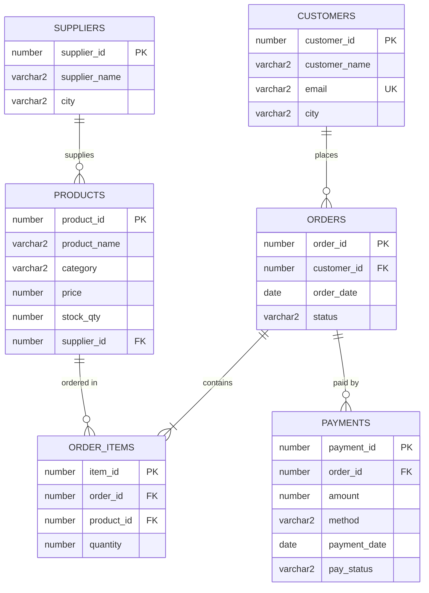

# E-Commerce Inventory & Order Processing Database

> A relational database project built in **Oracle SQL & PL/SQL** that manages suppliers, customers, products, orders, order items and payments of an online store, with automatic stock control.

**Course:** Database Management System (BTD50113)
**University:** Brainware University, School of Engineering
**Department:** Computer Science & Engineering – Cyber Security & Data Science
**Submitted to:** Paulamy Majee

## Team

| Member | Name | Student Code |
|---|---|---|
| 1 | Soumen Jana | BWU/BTD/24/073 |
| 2 | Soumen Das | BWU/BTD/24/074 |
| 3 | Sudipta De | BWU/BTD/24/079 |
| 4 | Kashif Iqbal | BWU/BTD/24/068 |
| 5 | Subir Ghosh Gope | BWU/BTD/24/123 |

---

## Overview

Small online sellers often track products and orders in spreadsheets, which leads to duplicate data, wrong totals and orders for items that are out of stock. This project replaces that with a normalized (3NF) Oracle database that enforces its own rules and automates routine work.

**Complete order cycle:** supplier provides products → customer places an order → order items are stored → stock is reduced automatically → payment is recorded → order moves from `Pending` to `Shipped` / `Delivered` / `Cancelled`.

## Features

- Six related tables with primary key, foreign key, unique, not null, check and default constraints
- Row-level **trigger** `trg_reduce_stock` that reduces stock when an order item is inserted
- Stored **procedure** `update_order_status` to change an order's status
- **View** `v_order_summary` with order totals, and an **index** on `orders(customer_id)`
- Reports using joins, `GROUP BY` and aggregates: order details, order totals, revenue by category, low-stock alert
- Over twenty sample records in each major table (5 suppliers, 20 customers, 20 products, 20 orders, 25 order items, 20 payments)

## Tech Stack

Oracle Database (SQL, PL/SQL) · Oracle FreeSQL / SQL Developer

---

## ER Diagram



`order_items` resolves the many-to-many relationship between orders and products into two one-to-many relationships.

## Database Schema

```sql
CREATE TABLE suppliers (
  supplier_id   NUMBER PRIMARY KEY,
  supplier_name VARCHAR2(60) NOT NULL,
  city          VARCHAR2(40)
);

CREATE TABLE customers (
  customer_id   NUMBER PRIMARY KEY,
  customer_name VARCHAR2(50) NOT NULL,
  email         VARCHAR2(80) UNIQUE,
  city          VARCHAR2(40)
);

CREATE TABLE products (
  product_id    NUMBER PRIMARY KEY,
  product_name  VARCHAR2(60) NOT NULL,
  category      VARCHAR2(40),
  price         NUMBER(10,2) CHECK (price > 0),
  stock_qty     NUMBER DEFAULT 0 CHECK (stock_qty >= 0),
  supplier_id   NUMBER REFERENCES suppliers(supplier_id)
);

CREATE TABLE orders (
  order_id      NUMBER PRIMARY KEY,
  customer_id   NUMBER REFERENCES customers(customer_id),
  order_date    DATE,
  status        VARCHAR2(20)
);

CREATE TABLE order_items (
  item_id       NUMBER PRIMARY KEY,
  order_id      NUMBER REFERENCES orders(order_id),
  product_id    NUMBER REFERENCES products(product_id),
  quantity      NUMBER CHECK (quantity > 0)
);

CREATE TABLE payments (
  payment_id    NUMBER PRIMARY KEY,
  order_id      NUMBER REFERENCES orders(order_id),
  amount        NUMBER(12,2),
  method        VARCHAR2(20),
  payment_date  DATE,
  pay_status    VARCHAR2(15)
);
```

## Index, View, Trigger and Procedure

```sql
CREATE INDEX idx_orders_customer ON orders(customer_id);

CREATE OR REPLACE VIEW v_order_summary AS
SELECT o.order_id, c.customer_name, o.order_date, o.status,
       SUM(p.price * i.quantity) AS order_total
FROM orders o
JOIN customers c   ON o.customer_id = c.customer_id
JOIN order_items i ON o.order_id    = i.order_id
JOIN products p    ON i.product_id  = p.product_id
GROUP BY o.order_id, c.customer_name, o.order_date, o.status;

CREATE OR REPLACE TRIGGER trg_reduce_stock
AFTER INSERT ON order_items
FOR EACH ROW
BEGIN
  UPDATE products
  SET stock_qty = stock_qty - :NEW.quantity
  WHERE product_id = :NEW.product_id;
END;
/

CREATE OR REPLACE PROCEDURE update_order_status (
  p_order_id IN NUMBER,
  p_status   IN VARCHAR2
) AS
BEGIN
  UPDATE orders SET status = p_status WHERE order_id = p_order_id;
  COMMIT;
END;
/
```

If an order asks for more pieces than are in stock, the trigger's update breaks the `stock_qty >= 0` check, so the insert is rolled back and stock never goes negative.

---

## Sample Reports

### Revenue by product category

```sql
SELECT p.category, SUM(i.quantity) AS units_sold, SUM(p.price * i.quantity) AS revenue
FROM order_items i JOIN products p ON i.product_id = p.product_id
GROUP BY p.category
ORDER BY revenue DESC;
```

| CATEGORY | UNITS_SOLD | REVENUE |
|---|---:|---:|
| Electronics | 7 | 10293 |
| Clothing | 7 | 5193 |
| Home | 8 | 4542 |
| Accessories | 10 | 4290 |
| Fitness | 3 | 3497 |
| Footwear | 1 | 2499 |
| Stationery | 8 | 1592 |
| Books | 1 | 549 |

### Low stock alert

```sql
SELECT product_id, product_name, stock_qty FROM products WHERE stock_qty < 10;
```

| PRODUCT_ID | PRODUCT_NAME | STOCK_QTY |
|---:|---|---:|
| 5 | Water Bottle | 8 |
| 15 | Ceramic Mug | 9 |
| 19 | SQL Basics Book | 6 |

### Trigger test

```sql
INSERT INTO order_items VALUES (26, 20, 3, 2);
SELECT product_id, product_name, stock_qty FROM products WHERE product_id = 3;
```

| PRODUCT_ID | PRODUCT_NAME | STOCK_QTY |
|---:|---|---:|
| 3 | Running Shoes | 18 |

Stock of *Running Shoes* dropped from 20 to 18 automatically.

---

## Testing

| Category | Tests | Passed |
|---|---:|---:|
| Functional (tables, data, joins, reports, view, trigger, procedure) | 10 | 10 |
| Validation (constraints and stock protection) | 5 | 5 |

Validation cases that the database must refuse:

| Statement | Rule tested | Expected Oracle error |
|---|---|---|
| Product with a negative price | `CHECK (price > 0)` | ORA-02290 |
| Customer with a duplicate email | `UNIQUE (email)` | ORA-00001 |
| Order for customer 99 (does not exist) | Foreign key | ORA-02291 |
| Order item with quantity 0 | `CHECK (quantity > 0)` | ORA-02290 |
| 10 pieces of a product with only 6 in stock | Trigger + `CHECK (stock_qty >= 0)` | ORA-02290 |

## Repository Contents

```
.
├── README.md                                          this file
├── PBL_Report_Ecommerce_Inventory_Order_DB_Final.pdf  full project report
└── scripts/
    ├── 01_drop_objects.sql            drop old objects
    ├── 02_create_tables.sql           six tables with constraints
    ├── 03_insert_data.sql             sample data
    ├── 04_queries.sql                 reports (Figures 3-8)
    ├── 05_index_and_view.sql          index and view (Figure 9)
    ├── 06_trigger_and_procedure.sql   trigger and procedure with tests (Figures 10-13)
    └── 07_validation_tests.sql        optional constraint tests (T11-T15)
```

## How to Run

1. Open [Oracle FreeSQL](https://freesql.com) (free account) or Oracle SQL Developer and choose a schema where you can create tables. Shared schemas such as `HR` are read-only.
2. Run the files in the `scripts` folder in the order of their numbers, `01` to `06`. Script `07` is optional.
3. Run each PL/SQL block with `/` on its own line after `END;`.
4. Compare the output with the figures in the PDF report.

Run `03` before `06`: the trigger is created after the data is loaded, so the starting stock matches the report.

## Limitations

- Back-end design only: no shopping website, payment gateway or delivery tracking
- Small practice data set; not tuned for very large volumes
- `payments.amount` is calculated when the payment row is loaded, so items added later are not included
- No partial payments, discounts, taxes or returns; access control is described but not implemented

## Future Scope

- Tables for coupons, reviews, shipping addresses, delivery partners and returns
- Automatic purchase orders when stock falls below a limit
- Trigger to keep the payment amount in sync with order items
- Role-based database users, audit tables, partitioning
- A web or mobile front end connected to this database, and dashboards on the reports

## References

1. Silberschatz, Korth and Sudarshan, *Database System Concepts*, 7th Ed., McGraw-Hill, 2019
2. Elmasri and Navathe, *Fundamentals of Database Systems*, 7th Ed., Pearson, 2016
3. Feuerstein and Pribyl, *Oracle PL/SQL Programming*, 6th Ed., O'Reilly, 2014
4. Codd, "A Relational Model of Data for Large Shared Data Banks", *Communications of the ACM*, 1970
5. Chen, "The Entity-Relationship Model – Toward a Unified View of Data", *ACM TODS*, 1976
6. Oracle Database SQL and PL/SQL Language References: https://docs.oracle.com/en/database/
